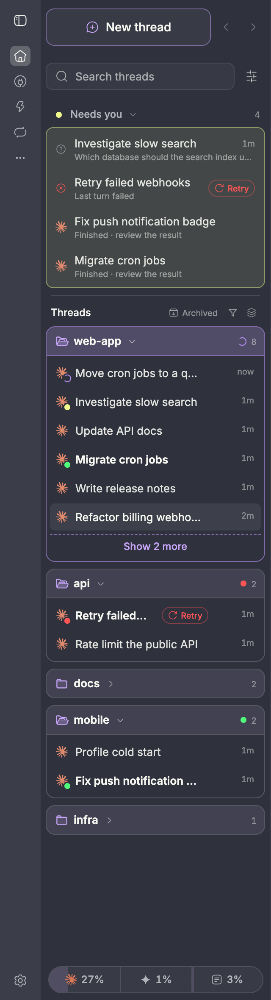
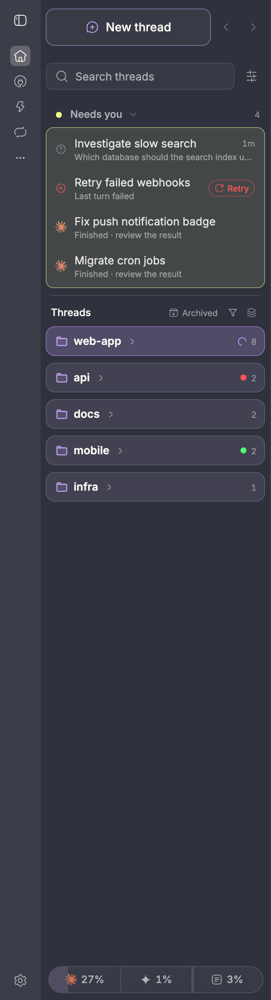
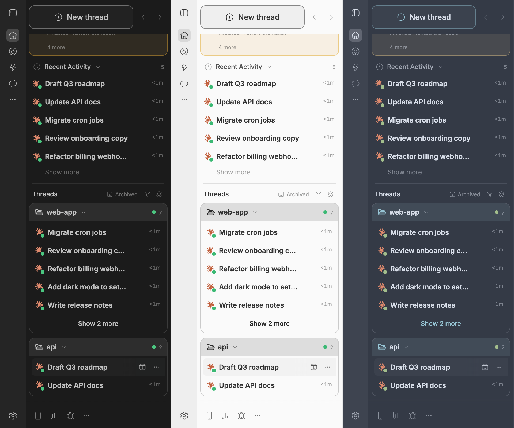
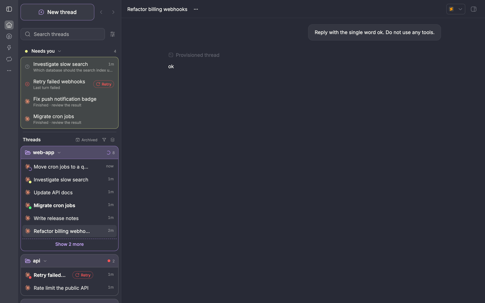

# Folio BB for bb

A restyle of the bb thread sidebar: project folders become cards with a sticky
header, threads inside a project sort by their last real activity, every row shows
the icon of the agent it runs on, and New thread becomes a full-width button.
All colors come from the active bb theme, so it fits every built-in palette in light
and dark mode.

Plugin id: `folio-bb`.





## What it changes

- **Project cards.** Each project folder is a bordered card. Its header stays
  pinned while the rows scroll under it.
- **Show N more.** A card shows its 5 most recently active threads (child threads
  ride along with their parent), then *Show N more* / *Show less*. The open thread
  and running threads are never hidden.
- **Sort by activity.** Threads inside a project, children included, are ordered by
  their latest turn (message sent, turn started or finished, error), newest first.
  Recent Activity follows the same order, working threads on top. The age label shows
  the same time: `now` only while a thread works, then `<1m`, `5m`, `3h`, `2d`.
  Tree lines are redrawn for the new order.
- **Status badges.** Every row shows the icon of its AI (Claude, Kimi, Antigravity and any
  other provider Thread Tree knows) with a small badge on its corner: a spinner in the accent
  color while it works, yellow when it waits for you, red when it failed, green when it finished
  and you have not read it yet. The colors are the theme's own `--attention`, `--destructive`
  and `--success`.
- **Folder rollup.** Left of each folder's thread count: a spinner if anything inside works
  (plus a red dot if something also failed), otherwise the most important state: failed, then
  waiting for you, then finished. Children and threads behind *Show N more* count too, and the
  badge stays on a collapsed folder.
- **The open thread's folder** gets a stronger header tint and an accent outline, collapsed or
  not, so you can tell where the thread you are reading lives.
- **New thread** is a full-width outlined button in the accent color.
- **Needs you** becomes a card tinted with the theme's attention color (or the
  accent, see settings); static key hints (`/`, `esc`, `⇧⌘I next`) and
  the status counters under the search field are hidden.



## Requirements

- bb 0.50 or newer.
- The [Thread Tree](https://github.com/kartollikaa/bb-plugins) plugin for the cards,
  sorting, ages, provider icons and Needs you styling. Without it only the New thread
  button changes. Thread Tree updates can change its markup; if a part stops
  applying, switch it off in the settings below and open an issue.

## Install

```sh
bb plugin install https://github.com/xaibu9/bb-plugin-folio.git
```

From a local checkout:

```sh
npm install
bb plugin build
bb plugin install . --yes
```

Remove with `bb plugin remove folio-bb`. The plugin only adds styles and data
attributes while it runs, so the sidebar returns to its usual look when it unloads.

## Settings

Settings → Installed plugins → Folio BB, or `bb plugin config folio-bb set <key> <value>`.

| Key | Default | What it does |
| --- | --- | --- |
| `accent` | `theme` | Accent color: `theme` follows the bb theme, or `#rrggbb` |
| `language` | `auto` | Labels for ages and *Show N more*: `auto` (browser language), `en`, `ru` |
| `pageSize` | `5` | Root threads a card shows before *Show N more*; `0` shows all |
| `projectCards` | `true` | Project folders as cards with a sticky header |
| `activitySort` | `true` | Sort threads by last activity and show its age |
| `providerIcons` | `true` | Provider icon in place of the gray dot |
| `newThreadButton` | `true` | Full-width New thread button |
| `hideCounters` | `true` | Hide the status counters and static key hints |
| `statusBadges` | `true` | Status badges on rows and the rollup on folders |
| `activeFolder` | `true` | Highlight the folder of the open thread |
| `needsYouAccent` | `false` | Tint Needs you with the theme accent instead of its attention color (the default theme's accent is gray) |

**Where the color comes from.** By default the accent is the active bb theme's accent
(`--primary`): change the theme with `bb theme set <theme>` and the sidebar follows.
To use your own color, open Settings → Installed plugins → Folio BB → Accent
color and pick a circle or type `#rrggbb` (the first circle goes back to the theme).
The same value is `bb plugin config folio-bb set accent '#7aa2f7'`.

The plugin publishes its accent as the CSS variable `--folio-accent` on the
page root (the theme accent when none is picked). Other plugins can follow it with
`var(--folio-accent, var(--primary))`; Fuel BB does, so the sidebar and
the limits strip share one color and change together.

Thread Tree's subagent counters can be turned off in Thread Tree itself:
`bb plugin config thread-tree set showSubagents false`.

## What it reads and stores

- Reads each thread's latest turn event through the bb plugin SDK
  (`threads.events.list`, one event per thread) when it starts and when a thread changes.
- Stores one timestamp per thread id in its own plugin storage, and the
  *Show more* state of each card in the window's session storage.
- Makes no network requests, reads no files and touches no accounts or credentials.

## Testing

`npm run e2e` starts a separate, throwaway bb (its own data folder and ports,
bundled plugins only), installs a copy of the plugin, then Thread Tree from the
catalog and a few one-word Claude Code threads (cheapest model), and checks the
cards, Show N more, ages, provider icons, the sticky header, Recent Activity order,
the accent picker and the plugin log in the default theme (dark and light) and Nord.
It needs bb.app, Google Chrome and a signed-in Claude Code; it stops the instance and
deletes its files at the end. Screenshots land in `e2e/out/`.

## Development

```sh
npm install
npm run typecheck
bb plugin build
```

`app.css` holds every style; colors are `--sp-*` variables built from bb theme tokens
(`--primary`, `--sidebar`, `--sidebar-foreground`, `--muted-foreground`).
`src/sidebarSync.ts` relabels and reorders Thread Tree rows without touching its React tree.

---

## По-русски

**Folio BB** меняет вид сайдбара bb. Папки проектов становятся карточками, и
их шапка остаётся на месте при прокрутке. Чаты внутри проекта идут по последней
активности, и рядом видно, сколько прошло: «сейчас», «5м», «3ч», «2д». В строке
стоит иконка ИИ, на котором работает чат, а на её углу кружок статуса: колесико — работает,
жёлтый — ждёт тебя, красный — ошибка, зелёный — закончил, а ты ещё не посмотрел. На шапке
папки слева от счётчика сводка по всем её чатам, видна и у свёрнутой. Папка открытого чата
подсвечена. Кнопка New thread
растянута на всю ширину. В карточке видно 5 последних чатов, остальные открываются
кнопкой «Ещё N». Открытый и работающие чаты не прячутся никогда.

Цвета берутся из текущей темы bb, поэтому пакет подходит ко всем встроенным темам,
светлым и тёмным. Акцентный цвет по умолчанию тоже из темы (в Dracula он фиолетовый).
Свой цвет выбирается в Settings → Installed plugins → Folio BB → Accent color:
кружки или поле `#rrggbb`, первый кружок возвращает цвет темы. Этот цвет плагин
публикует в CSS-переменной `--folio-accent`, и Fuel BB берёт его оттуда,
поэтому у сайдбара и полосы лимитов один цвет.

Для карточек, сортировки и иконок нужен плагин Thread Tree. Без него меняется только
кнопка New thread.

Установка: `bb plugin install https://github.com/xaibu9/bb-plugin-folio.git`.
Удаление: `bb plugin remove folio-bb`.

Настройки: Settings → Installed plugins → Folio BB. Там язык подписей, сколько
чатов показывать в карточке (0 — все) и выключатели каждой части.

Плагин читает только время последнего хода каждого чата через SDK bb и хранит его
в своём хранилище. В сеть не ходит, файлы не читает, к аккаунтам и паролям доступа нет.
